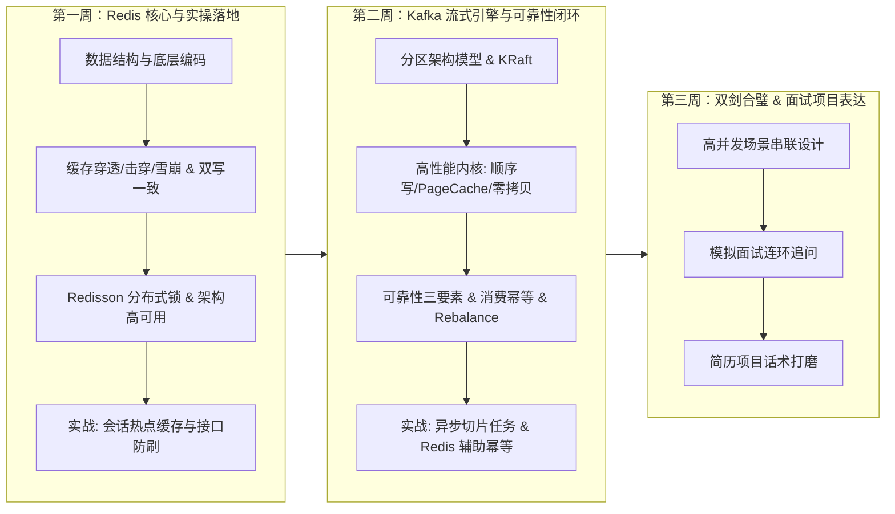

# Redis 与 Kafka 面试冲刺与工程实战规划指南 (Study & Interview Plan)

> **目标**：以应对国内/外企 Java 后端技术面试为导向，结合本项目（`MyAgent` 智能体系统）进行“**八股理论吃透 + 底层原理剖析 + 容器环境演练 + 生产级代码实战**”的一体化学习。  
> 告别脱离实际的死记硬背，将中间件能力转化为简历中**真实可讲的高并发项目亮点**。

---

## 🎯 核心结论：先学哪个？

### 推荐顺序：**先攻克 Redis，再进阶 Kafka**

| 比较维度 | Redis | Kafka | 先后顺序结论 |
| :--- | :--- | :--- | :--- |
| **认知门槛** | 内存 K-V 结构，直观契合面向对象思维，开箱即用，上手极快。 | 分布式分区、副本同步、位移、消费者组、重平衡，概念抽象且体系庞大。 | **先易后难**，更易获得正向反馈 |
| **依赖关系 (关键!)** | 独立自洽，为很多分布式系统提供元数据存储与锁服务。 | **Kafka 解决“消费幂等防重”核心方案就是借助 Redis**（`SETNX` / 去重）。 | **先 Redis 后 Kafka**，学到 MQ 幂等时能顺理成章用 Redis 兜底 |
| **面试覆盖率** | 几乎 **100%** 的 Java 后端岗位必问，无论初级、高级还是业务线。 | 偏向高并发、大数据、微服务解耦场景，常作为进阶考察项。 | **Redis 投资回报率更高**，能迅速建立面试底气 |
| **与本项目融合度** | 立即为会话历史做 **L1 内存缓存加速** + **API 限流** + **防重复提交锁**。 | 为知识库文档上传、大模型长耗时切块做**异步削峰解耦**。 | 业务演进上先有热点加速，再有异步削峰 |

---

## 📅 三周高效学习与实战时间表

---

### 第一周：Redis 核心攻坚（从八股到底层）

#### 📌 Day 1-2：5 大核心数据结构与底层编码
* **掌握目标**：
  * **String**：底层动态字符串（SDS）对比 C 原生字符串的优势（O(1) 获取长度、空间预分配防溢出、二进制安全）。
  * **List**：Quicklist（双向链表 + 压缩列表 Listpack）。
  * **Hash**：Dict 字典结构，渐进式 rehash（两张哈希表平滑扩容迁移）机制。
  * **Set**：Intset 整数集合与 Dict 的转换。
  * **ZSet（重点必考）**：跳表（SkipList）+ ZipList/Listpack 原理；为什么不用平衡树/红黑树做跳表？（范围查询跳表简单高效、实现复杂度低）。
* **自测问题**：
  1. Redis 一个字符串键最大支持多少字节？（512MB）
  2. ZSet 的底层数据结构是什么？跳表的查询复杂度是多少？（平均 $O(\log N)$）

#### 📌 Day 3-4：缓存核心三大痛点与双写一致性
* **掌握目标**：
  * **缓存穿透**：定义与解法（布隆过滤器 Bloom Filter 误判率原理、空对象缓存短 TTL）。
  * **缓存击穿**：热点 Key 失效瞬间并发打垮 DB；解法（互斥锁、逻辑过期异步更新）。
  * **缓存雪崩**：集中失效或 Redis 宕机；解法（TTL 随机偏移散列、高可用集群、限流降级）。
  * **数据一致性**：为什么优先选择 **Cache-Aside 策略**（先改 DB，再删缓存）？
    * 延迟双删的原理与短板。
    * 终极解法：监听 MySQL Binlog（Canal）异步清理缓存。
* **自测问题**：
  1. 为什么是“先更新数据库，再删除缓存”，而不是“先删除缓存，再更新数据库”？
  2. 为什么是“删除缓存”而不是“更新缓存”？（Lazy 计算思想，避免频繁计算冷数据）。

#### 📌 Day 5-6：分布式锁、内存淘汰与高可用
* **掌握目标**：
  * **分布式锁演进**：
    * `SET key val NX` 缺少超时 -> 死锁。
    * `SET key val NX EX 30` 超时过短被误删 -> 加唯一 requestId。
    * 释放锁原子性 -> Lua 脚本保证判等与删除原子。
    * 业务耗时超出锁时长 -> Redisson 看门狗（Watchdog）每隔 1/3 时间自动续期底层机制。
  * **内存淘汰策略**：LRU（最近最少使用）与 LFU（最不经常使用），Redis 的近似 LRU 实现机制。
  * **持久化与高可用**：
    * RDB（COW 写时复制 `bgsave`）与 AOF（写后日志、`appendfsync` 三种策略、后台重写 rewrite）。
    * 主从同步（全量 psync + 增量积压缓冲区 repl_backlog）。
    * 哨兵（Sentinel）选主仲裁与 Cluster（16384 哈希槽）路由。

#### 📌 Day 7：在当前 `MyAgent` 工程中落地实战
* 在 `docker-compose.yml` 中追加 Redis 服务。
* 在当前项目中引入 `redisson-spring-boot-starter`。
* **实战任务**：
  1. 为已有的 `PostgresChatMemoryStore` 加上二级缓存：优先读 Redis 活跃会话，过期或缺失时回源 PostgreSQL。
  2. 基于 Redisson 实现一个简单的接口防刷 / 防重复提问注解切面。

---

### 第二周：Kafka 流式引擎攻坚（从原理到容错）

#### 📌 Day 8-9：核心拓扑架构与 KRaft 新机制
* **掌握目标**：
  * 核心实体：Broker、Topic、Partition（水平切分与高并发本质）、Offset（单分区有序保证）。
  * 消费者组（Consumer Group）：
    * 分区与消费者的 1 对 1 约束（同一个 Group 内一个 Partition 只能被一个 Consumer 消费；但一个 Consumer 可以消费多个 Partition）。
  * **KRaft 机制**：
    * 过去依赖 ZooKeeper 的弊端（网络元数据同步延迟大、元数据上限瓶颈、双系统维护成本高）。
    * KRaft 基于 Raft 协议在 Broker 内选举 Controller Quorum，实现元数据秒级恢复与轻量化部署。

#### 📌 Day 10-11：高性能底层内核（百万 QPS 的秘密）
* **掌握目标**：
  * **磁盘顺序读写（Sequential I/O）**：追加写入（Append-only），避开机械臂寻道/随机写开销。
  * **利用 OS 页缓存（PageCache）**：进程无锁直接依赖内核缓存，绕开 JVM GC 与堆内存开销。
  * **零拷贝（Zero-Copy）**：
    * 传统 4 次上下文切换与 4 次数据拷贝。
    * Kafka 借助 `sendfile` 系统调用实现 DMA 直接在内核缓冲区与网卡之间流转。
  * **分批（Batching）与压缩（Snappy/zstd）**：网络 I/O 摊薄开销。

#### 📌 Day 12-13：消息可靠性、幂等性与消费者重平衡
* **掌握目标**：
  * **消息防丢三件套（必背）**：
    1. 生产端：`acks=all` + 充分重试 `retries`。
    2. 服务端：`replication.factor >= 3` + `min.insync.replicas >= 2` + 关闭脏选举。
    3. 消费端：关闭自动提交 `enable.auto.commit = false`，改为**业务逻辑执行完毕后手动提交**。
  * **消费端幂等（利用第一周学过的 Redis！）**：
    * 全局唯一业务 Key（如 TaskId / MsgId）。
    * 消费前先通过 Redis 执行 `SETNX msg_id 1 EX 3600`，已存在则直接 ACK 跳过。
  * **顺序消费保证**：同一业务 Key 发往同一 Partition。
  * **Rebalance（重平衡）**：
    * 触发场景（组员崩溃、新组员加入、Topic 扩容）。
    * 规避频繁 Rebalance（调优 `session.timeout.ms` 与 `max.poll.interval.ms`）。

#### 📌 Day 14：在当前 `MyAgent` 工程中落地实战
* 在 `docker-compose.yml` 中追加单节点 KRaft Kafka 与 Kafka-UI。
* 在项目中引入 `spring-kafka`。
* **实战任务**：
  * 编写知识库大文档异步解析流水线：
    * 用户上传大型文档后，Controller 只发一条包含 `documentId` 的 Kafka 消息并立即返回 `202 Accepted`。
    * 后台消费者监听消费，调用 Embedding 写入 Qdrant，结合 Redis 保证不会重复处理已成功的切片。

---

### 第三周：场景串联、模拟面试与简历包装

#### 📌 Day 15-17：高频面试真题连环拷问攻坚
1. **连环追问 1（Redis 锁）**：
   * “你用过 Redis 分布式锁吗？怎么实现的？” -> “如果业务执行超时了锁提前释放怎么办？” -> “Redisson 的看门狗是怎么续期的？” -> “主从架构下主节点挂了锁丢失怎么处理？了解红锁吗？”
2. **连环追问 2（MQ 可靠性）**：
   * “你们系统消息队列会丢消息吗？怎么设计的？” -> “如果消费者一直失败报错，消息怎么处理？” -> “死信队列（DLQ）如何接入？” -> “消费堆积了上百万条消息怎么排查与应急扩容？”
3. **连环追问 3（双写一致）**：
   * “缓存和数据库不一致怎么解决？” -> “延迟双删的延迟时间怎么定？” -> “如果第二步删除缓存失败了怎么办？（Canal + 重试队列）”

#### 📌 Day 18-21：简历项目亮点话术打造
把在 `MyAgent` 项目中的实操沉淀为简历上的强竞争力描述：
* **亮点描述范例**：
  > “针对大模型多轮对话场景，设计了 **Redis 内存热点缓存 + PostgreSQL 关系快照** 的二级会话存储架构。活跃会话查询命中率提升 90%，响应耗时降低至毫秒级；基于 **Redisson 分布式锁与看门狗续期** 实现了高并发提问下的用户级幂等控制与接口防刷。”
  > 
  > “针对知识库海量文档向量化（Embedding）耗时长、容易阻塞 HTTP 连接并引发接口超时的痛点，引入 **Kafka 实现了文档切块任务的异步解耦与削峰填谷**。通过配置 `acks=all` 与最小同步副本数保障零丢消息，消费端结合 **Redis SETNX 实现全局唯一 TaskId 的幂等校验**，并配置手动提交位移，支撑高吞吐文档并发摄取。”

---

## 🛠️ 下一步行动建议

1. **第一步（今天即可开始）**：我们在 `docker-compose.yml` 中补充 Redis 容器，并在 Spring Boot 中接入 Redis / Redisson 练习基本 API。
2. **第二步**：对照本规划的 Day 1-4 知识点系统梳理笔记。
3. **第三步**：完成后自然过渡到 Kafka 章节。
